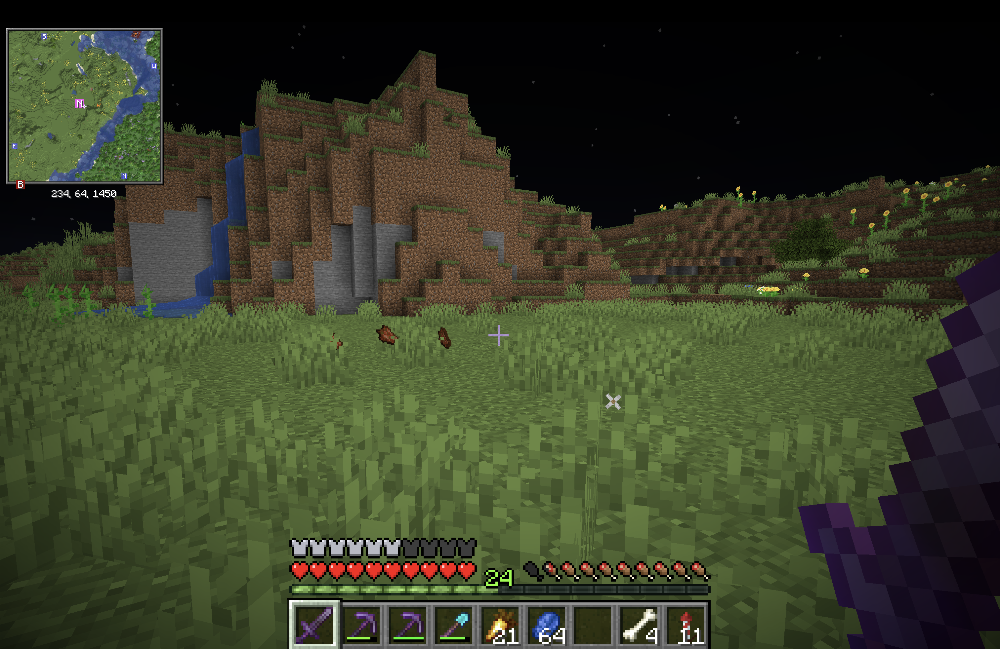
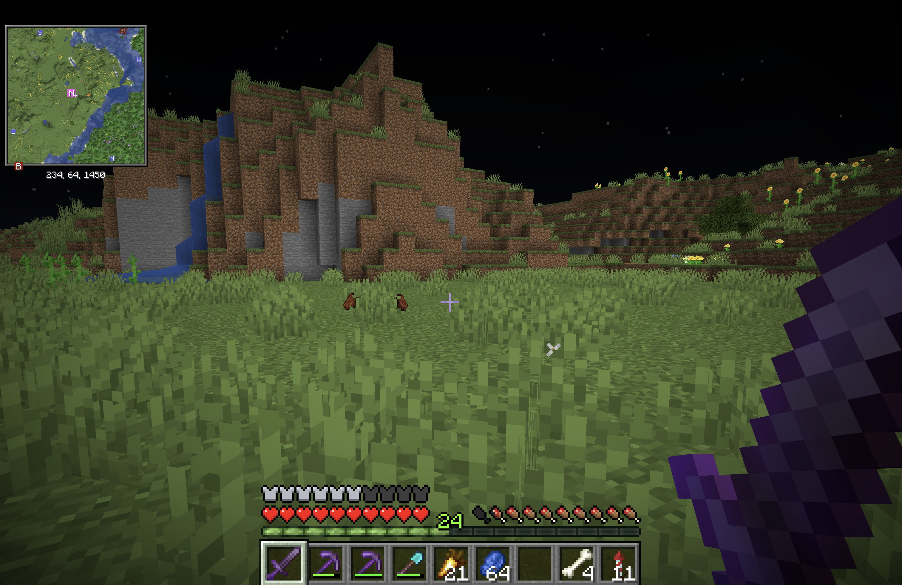

# Mac Polish

Fixes for Minecraft 26.3 on Mac. Client-side Fabric mod, does nothing on other systems.

| Before | After |
|---|---|
|  |  |

## Features

- Keeps your cursor locked and hidden after Cmd-Tab, so it can't open the Dock or menu bar mid-game
- Moves held items back to where they'd sit on a 16:9 screen, since Mac screens cut off more of them
- Optional fix for Shift+scroll going the opposite way to normal scrolling, off by default

## Install

Needs Fabric Loader and Java 25. Fabric API isn't needed.

```sh
./gradlew build
```

Move `build/libs/macpolish-1.0.0.jar` to your `mods` folder.

Only tested on one notched Apple Silicon MacBook on macOS 26.5.2, so open an issue if it acts differently on yours.

## Settings

With Mod Menu, open Mods, select Mac Polish, and click the settings icon. Changes apply right away.

Without it, edit `config/macpolish.properties` and restart.

| Setting | Default | Fix |
|---|---|---|
| `pointerLockRepair` | `true` | Cursor after Cmd-Tab |
| `heldItemFraming` | `true` | Held items |
| `flipShiftScroll` | `false` | Shift+scroll |

## How it works

**Cursor.** After a focus change, SDL 3.4.14 can get stuck in its "focus click pending" state. It then skips locking the pointer and hiding the cursor, but still reports relative mode as on. This clears that state through SDL's own window listener, so SDL applies the lock again. It waits while a mouse button is held, and turns itself off if a future SDL renames these methods.

**Held items.** Slides the hand toward the center by the difference between your screen and 16:9. It uses a shear instead of a 3D move, so the item looks the same as it would at 16:9. Screens at 16:9 or wider are unchanged, two-handed maps stay centered, and an empty hand stays where it normally is.

**Shift+scroll.** Vanilla is right on a stock Mac. It only comes out reversed when something changes vertical scrolling but not horizontal, like Scroll Reverser setting your mouse to Classic while macOS stays on natural.

## Development

```sh
./gradlew test
./gradlew runClientGameTest
```

The game test renders the held item at 16:9 and at Mac aspect ratios, with screenshots in `build/run/clientGameTest/screenshots`.

## License

MIT
